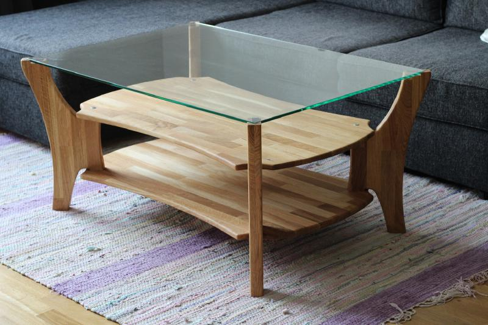

# Coffee table CT1

CT1 is a parametric cadquery model of a coffeetable.



Fullscreen [3D-model](https://blog.gntech.se/en/models/ct1/) of the coffee table

Read more about the design on my website https://blog.gntech.se/en/projects/ct1/

## How to build the model

To run the model from command line you can install cadquery using pip in an venv.

``` bash
./setup-toolchain.sh
```

Then run the ct1.py script from the terminal.

``` bash
./ct1.py
```

Or open `ct1.py` in the CQ-editor that has cadquery included.

See instructions here [Install cadquery](https://cadquery.readthedocs.io/en/latest/installation.html)

## Building in SolidCraft

The table can also be built in [SolidCraft](https://bherbruck.github.io/solidcraft/) through its
[MCP server](https://bherbruck.github.io/solidcraft/guide/mcp.html). The scripts drive a running
SolidCraft window, so you can watch the model being built step by step.

Start SolidCraft with a control port:

``` bash
solidcraft --control 7878
```

Then run a build script (Python 3.8 or later, no extra packages needed):

``` bash
python ct1_solidcraft.py
python ct1_solidcraft.py --length 1500 --width 650
```

Each script is split into stages that can be run one at a time, for example
`python ct1_solidcraft.py new leg`. The results are saved in `build/` as a SolidCraft design,
a STEP file, a render and DXF profiles.

- `sc.py` is a small client for the SolidCraft MCP server. It can also be used from the
  command line, e.g. `python sc.py list_commands '{"filter": "sketch"}'`.
  Set `SOLIDCRAFT_CLI` if `solidcraft-cli.exe` is not in `C:\Program\SolidCraft`.
- `ct1_solidcraft.py` builds CT1 as in `ct1.py`: one leg component placed four times and one
  shelf component placed twice. Other sizes can be built with `--length` and `--width`.
  SolidCraft 0.12 cannot round the curved edges of the legs, so that step from `ct1.py` is left out.

## CT3, a flat-pack table for CNC routing

`ct3_solidcraft.py` builds CT3, a coffee table made to be cut from a single sheet of 18 mm
plywood on a CNC router. It is 1100 × 600 × 450 mm and needs no screws, hardware or glue.

- The two legs have tenons that go through the top and finish flush with its surface.
- The shelf goes through both legs and is locked with four knock-in wedges, which pull the
  frame tight.
- All inside corners have dogbones for a 6.35 mm router bit, and the joints have 0.2 mm
  clearance per side.
- The cutting profile of each part is exported to `build/ct3_top.dxf`, `ct3_leg.dxf` (cut 2),
  `ct3_shelf.dxf` and `ct3_wedge.dxf` (cut 4). The DXFs are in millimetres.

Before cutting, measure the actual thickness of the plywood and set `PLY_T` at the top of
`ct3_solidcraft.py`. The bit diameter (`BIT_D`) and joint clearance (`CLEAR`) are set there too.
Cut a test joint from an offcut first, and run a roundover bit along the visible edges.

## License

The design is licensed under the CERN OHL v.1.2, see [LICENSE](LICENSE).
